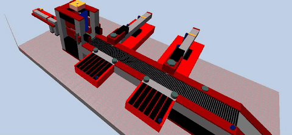
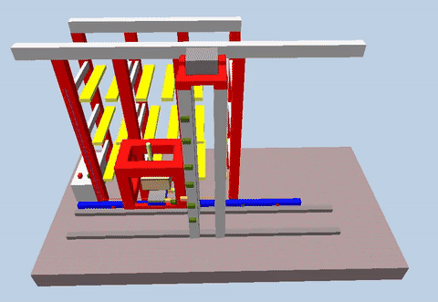

# Real-time systems: conveyor, warehouse and car wash

Real-Time Systems (STR), 2023/2024 · C++, FreeRTOS, Java (JNI), Petri nets.

Three lab projects, each controlling a simulated industrial plant through digital I/O ports. The
plants, the simulator server, FreeRTOS and the NI-DAQ interface libraries were provided by the
course and are **not** included here; this repository holds only our code, so it reads as a
reference rather than building on its own. The clips below were recorded from the course's web
simulators driven through their I/O ports by a short scripted sequence, to show the plants.

## 1. Splitter conveyor (`1-splitter-conveyor/`)

A conveyor carries bricks of three types past magnetic sensors; two cylinders push each brick into
the right lane, and wrong bricks are rejected. Written as FreeRTOS tasks on the Windows port:

- one task per actuator and sensor (conveyor on/off, entry cylinder, cylinders 1 and 2,
  magnetic sensors, brick sorter), synchronised with counting semaphores and a queue that passes
  the detected brick type from the sensor task to the sorter;
- a manual calibration task run at start-up;
- a controller task for the keyboard: choose the brick type to accept, see the history of
  accepted and rejected bricks with timestamps, and per-type counts;
- interrupt-style handlers for the plant's switches.

`my_interaction_functions.*` wraps the port I/O (bit reads and writes, cylinder and conveyor
commands).

*The course's splitter-conveyor simulator: the entry cylinder pushes bricks onto the belt, which
carries them past the two sorting cylinders. ([MP4](media/conveyor.mp4))*

## 2. Automated pallet storage (`2-pallet-storage/`)

A 3 × 3 warehouse served by a stacker crane with X, Y and Z axes. The control program is in Java,
reaching the hardware ports through a JNI DLL written in C:

- `java/`: one thread per axis, a calibration thread, an emergency-stop and reset path, and a
  menu to add a pallet (with reference code and shipment date), remove one by reference or by
  position, and list pallets and occupancy; a date thread
  queues pallets for removal once their shipment date has passed.
- `jni/`: `storage_jni.c` exports the `Storage` class's native methods (axis movement, sensor
  reads, LEDs) on top of the course's port interface.

*The course's pallet-storage simulator: the stacker crane carries a pallet along X and lifts it
towards the shelves. ([MP4](media/storage.mp4))*

## 3. Car wash (`3-car-wash/`)

The car-wash station is controlled by a Petri net modelled in the course's HPSim tool, which calls
a DLL for every transition and place. `dllmain.cpp` holds those handlers (brush up/down/left/right,
contour detection, initialisation) and `carwash.cpp` the station's I/O.

The car wash runs in the course's HPSim tool on Windows, so there is no recording of it here.

## License

GPL-3.0, see [LICENSE](LICENSE).
